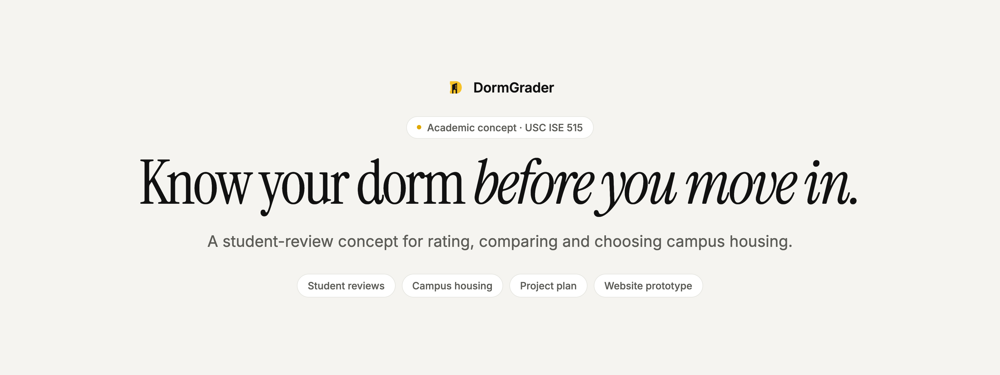
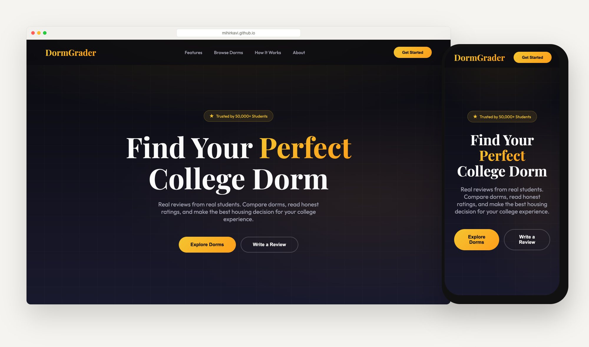
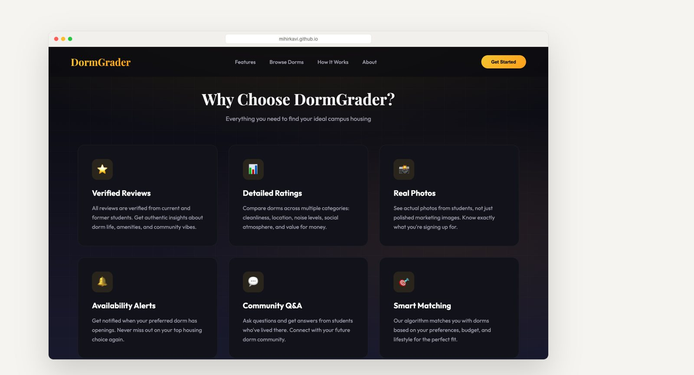
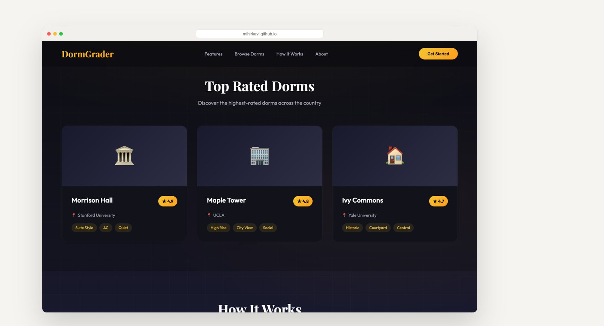
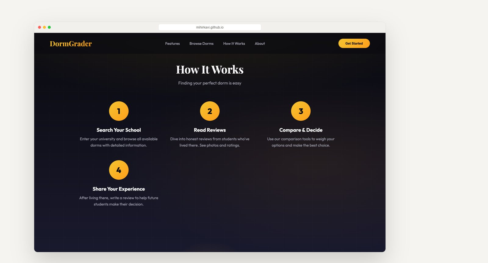

  <a href="https://mihirkavi.github.io/DormGrader/">
    <picture>
      <source media="(prefers-color-scheme: dark)" srcset=".github/assets/banner-dark.png">
      
    </picture>
  </a>

  <strong>Know the dorm before you sign for it.</strong> 
  DormGrader is a concept for a student-review app where residents rate campus housing, so the next class can compare dorms on what living there is really like.

  <a href="https://mihirkavi.github.io/DormGrader/"><strong>Website prototype</strong></a> ·
  <a href="#a-quick-tour"><strong>Tour</strong></a> ·
  <a href="#whats-in-this-repository"><strong>Project package</strong></a> ·
  <a href="#honest-status"><strong>Honest status</strong></a>

  
  
  
  

  

The prototype's marketing copy, such as "Trusted by 50,000+ students", is placeholder text for the concept. DormGrader has no users or reviews.

## Why DormGrader

Choosing a dorm is one of the first big decisions a student makes, and it is usually made from a floor plan, a few polished photos and a housing-office brochure. What matters most (noise, cleanliness, the social scene, the real size of the room) only becomes clear after move-in.

**DormGrader puts the people who lived there in charge of the ratings.** Former and current residents would score each building across a few clear categories, add their own photos and answer questions, and incoming students would compare halls side by side. The project began as a USC Housing mobile-app concept and was planned end to end as a project-management case study.

<table>
  <tr>
    <td width="33%" valign="top">
      <h3>⭐ Reviews from residents</h3>
      Ratings come from students who actually lived in the building, not from marketing copy.
    </td>
    <td width="33%" valign="top">
      <h3>📊 Compare what matters</h3>
      Score halls on cleanliness, location, noise, social life and value, then compare them side by side.
    </td>
    <td width="33%" valign="top">
      <h3>💬 Ask before you move</h3>
      Community questions and real photos help you know exactly what you are signing up for.
    </td>
  </tr>
</table>

## A quick tour

The website prototype is a single static page that shows how the product would look and feel.

<table>
  <tr>
    <td width="50%" valign="top">
      
      <h4>The features</h4>
      Six proposed features, from verified reviews to preference-based matching.
    </td>
    <td width="50%" valign="top">
      
      <h4>Dorm cards</h4>
      How a rated hall could appear. The dorms and ratings shown are sample content.
    </td>
  </tr>
</table>

  
   <strong>How it works:</strong> search your school, read reviews, compare, then pay it forward with your own review.

Screenshots of the live GitHub Pages prototype, captured with a headless browser.

## What's in this repository

The repository preserves the full project-management package developed for **USC ISE 515**, plus the website prototype.

| | Document | What it covers |
| --- | --- | --- |
| 📘 | **Final project report** and **final presentation** | The complete plan for building and launching DormGrader |
| 💰 | **Business case** and **NPV analysis** | Whether the app is worth building, in numbers |
| 🗂️ | **Project charter** | Scope, goals and stakeholders |
| 📅 | **Schedule, work breakdown and budget** | How the work would be organized and funded |
| ⚠️ | **Risk, resource, stakeholder and change plans** | How the project would be managed |
| 🌐 | **`index.html`** | The single-file website prototype, live on [GitHub Pages](https://mihirkavi.github.io/DormGrader/) |

## View it

- **Website:** open [the live prototype](https://mihirkavi.github.io/DormGrader/), or open `index.html` in any browser. There is no build step.
- **Documents:** open the reports, spreadsheets and slides in any Office-compatible app.

## Honest status

DormGrader is an **academic product concept and project-planning archive**, not a maintained or deployed service.

- The website is a **static mock-up**. Search, reviews, sign-up, alerts and matching are not implemented; the buttons do not lead to working features.
- The statistics on the page ("50,000+ students", "25K+ reviews", "500+ universities", ratings) and the sample dorm cards are **placeholder content**, not real data.
- No student data is collected or stored anywhere.

<!-- project-artwork:start -->
## Project artwork

Conceptual project artwork, not a product screenshot. [Asset files, design notes, and generation prompts](assets/brand/README.md).
<!-- project-artwork:end -->

## License

No license file is included in this repository. This README grants no additional reuse or redistribution permissions; contact the repository owner about permitted use.

   
   
  <strong>DormGrader</strong> · Know your dorm before you move in.

